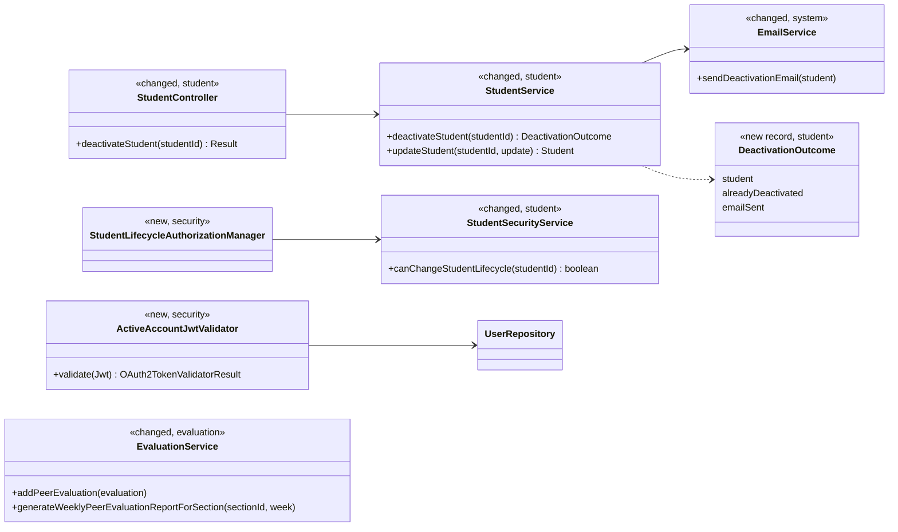
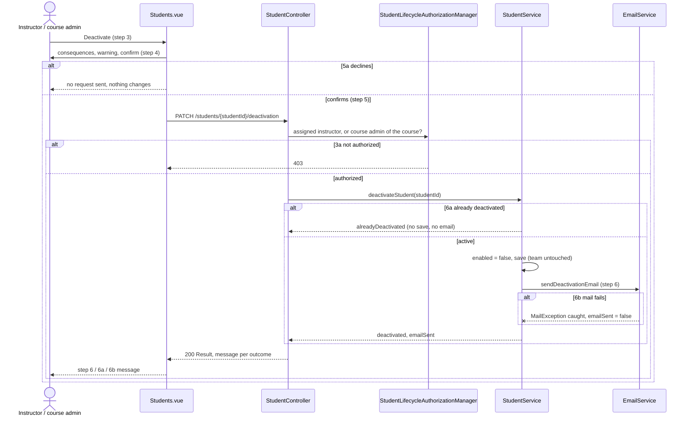
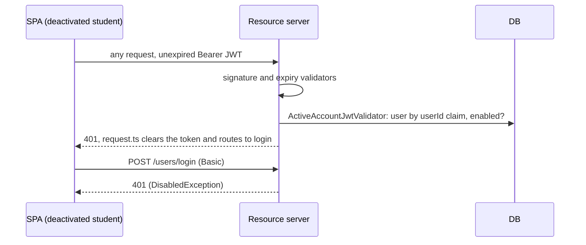
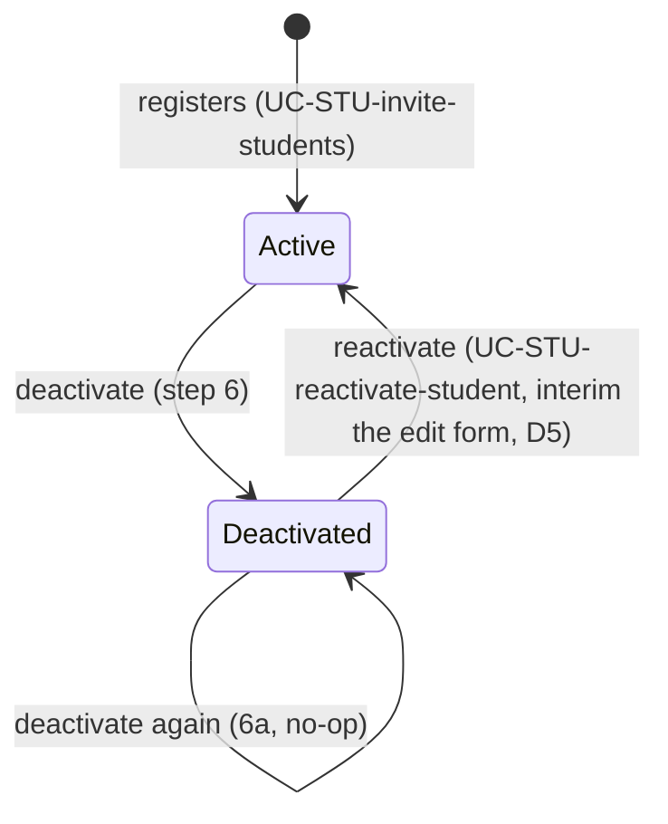

# Students (STU) Design

> Realizes: UC-STU-deactivate-student (with its consequences for UC-EVA-submit-evaluation extension 9a and the UC-EVA-section-evaluation-report listing rule)
> Depends on: FR-SEC-active-account, FR-SEC-authorization, FR-SEC-deny-unauthorized; BR-student-lifecycle, BR-section-scoped-access, BR-submission-owed, BR-role-based-access
> See: [use cases](../requirements/use-cases.md#uc-stu-deactivate-student-the-course-admininstructor-deactivates-a-student), [business rules](../requirements/business-rules.md), [architectural-design.md](architectural-design.md#crosscutting-concepts) (Authorization, Architectural conventions)
> Designed against `main` at `59f0267` (2026-11-06).

## Overview

This area owns a student's account lifecycle. Deactivation is one state change, `PeerEvaluationUser.enabled` going from true to false. It never touches team membership or submitted work (BR-student-lifecycle). The design gives that change one door, a dedicated endpoint that carries the use case's warning, email, and extensions. It then makes the rest of the system honor the state consistently:
- the resource server refuses a deactivated account's live JWT (FR-SEC-active-account);
- the peer evaluation slice stops evaluating her and lists her in the section report only when she was evaluated;
- the notification slice already excludes her from owing (`SubmissionStatusService`, unchanged).

Before this design, deactivation was a side effect of `PUT /students/{id}` toggling `enabled`. It had no warning and no email, it admitted only assigned instructors, and a deactivated student kept working for up to two hours on her token. The evaluation form and `addPeerEvaluation` also still asked for, and accepted, evaluations of her.

## Components & classes

- Backend:
  - [StudentController.java](../../backend/src/main/java/team/projectpulse/student/StudentController.java) and [StudentService.java](../../backend/src/main/java/team/projectpulse/student/StudentService.java) are changed. They gain the deactivate handler and service method, and `updateStudent` may only reactivate (decision D5).
  - [StudentSecurityService.java](../../backend/src/main/java/team/projectpulse/student/StudentSecurityService.java) is changed, with a new lifecycle check (decision D4).
  - `security/authorizationmanagers/StudentLifecycleAuthorizationManager.java` is new, plus one route rule in [SecurityConfiguration.java](../../backend/src/main/java/team/projectpulse/security/SecurityConfiguration.java).
  - `security/ActiveAccountJwtValidator.java` is new, added to `jwtDecoder()` through a `DelegatingOAuth2TokenValidator` alongside the default validators. This is the **shared trunk change**: it governs every bearer request, for students and instructors alike.
  - [EmailService.java](../../backend/src/main/java/team/projectpulse/system/EmailService.java) is changed, adding a sender that follows the pattern of the existing ones.
  - [EvaluationService.java](../../backend/src/main/java/team/projectpulse/evaluation/EvaluationService.java) and [PeerEvaluationAverage.java](../../backend/src/main/java/team/projectpulse/evaluation/PeerEvaluationAverage.java) are changed: the 9a check, the listing rule, and a `deactivated` field.
  - [SubmissionStatusService.java](../../backend/src/main/java/team/projectpulse/notification/SubmissionStatusService.java) is reused unchanged. It already applies BR-submission-owed's "account is active" condition.
- Frontend:
  - `apis/student` gains `deactivateStudent`.
  - [Students.vue](../../frontend/src/pages/students/Students.vue) gains a Deactivate row action, shown only for an active student. It opens an `ElMessageBox` with the Associated Information consequences (step 4) and shows the server's message as the result.
  - [EditStudentForm.vue](../../frontend/src/pages/students/EditStudentForm.vue) shows the status toggle only for a deactivated student.
  - [SubmitTeamsEvaluations.vue](../../frontend/src/pages/evaluations/SubmitTeamsEvaluations.vue) lists only `enabled` teammates.
  - The section peer evaluation report view tags a `deactivated` row "Deactivated".

## Sequence

### UC-STU-deactivate-student: deactivate a student

### FR-SEC-active-account: a live session is cut off

### Account state

## API contract

| Endpoint or job | Caller (who may) | Request | Success | Errors, by extension |
|---|---|---|---|---|
| `PATCH /api/v1/students/{studentId}/deactivation` | an instructor assigned to the student's course section, or the course admin of the course it belongs to | none | `200`. Data: the student, `alreadyDeactivated`, `emailSent`. Message: step 6 "<student name> has been deactivated."; 6a "<student name> was already deactivated."; 6b "<student name> has been deactivated, but the notification email could not be sent." | 3a: `403`, and an id naming no student is also `403` (fail-closed manager); 5a: no request is sent |
| `PUT /api/v1/students/{studentId}` (changed) | unchanged | `enabled: false` for an active student | unchanged otherwise | `400` "Use Deactivate to deactivate a student." (D5) |
| `POST /api/v1/evaluations` (changed) | unchanged | the evaluatee is deactivated | unchanged | UC-EVA-submit-evaluation 9a: `400` "A deactivated team member is not evaluated." |
| `GET /api/v1/evaluations/sections/{sectionId}/week/{week}` (changed) | unchanged | unchanged | each row gains `deactivated`; a deactivated student appears only if she received at least one peer evaluation that week | unchanged |
| any request with a bearer token | — | a JWT whose `userId` names a deactivated account | — | `401` |

## Key decisions

- **D1: A dedicated `PATCH /students/{studentId}/deactivation`.** Rejected: keeping deactivation as `enabled: false` on `PUT /students/{studentId}`. A generic profile update can't carry the warning, the email, or the 6a no-op, and it hides a lifecycle change inside a field edit.
- **D2: The session cut-off is a JWT validator that reads `enabled` on each request.** Rejected: a shorter token lifetime, which narrows the window but still leaves one; and a revocation denylist, which adds server state and works against the stateless, multi-instance deployment. Cost: one primary-key read per authenticated request, which is acceptable at about 75 users. The validator fails closed, so a `userId` claim naming no user is refused.
- **D3: The email is sent inside the service after the save, and a `MailException` is caught** (6b). An SMTP failure therefore never rolls back the deactivation, and the outcome still reaches the instructor in the same response. Rejected: an `AFTER_COMMIT` event listener. It can't report `emailSent` back synchronously, so 6b1 would be unmet. The residual risk, an email sent and then a commit that fails, is accepted as negligible for a single-row update.
- **D4: Authorization is a new `canChangeStudentLifecycle` check.** It admits the assigned instructor or the course admin of the student's course, per BR-student-lifecycle and BR-section-scoped-access. Rejected: widening the shared `isCurrentUserInstructorOfStudentSection`. That method guards five other routes (student GET/PUT/DELETE, evaluation details, and others) that have the same course-admin gap. Fixing them is a separate access change, tracked as OI-65.
- **D5: The edit-form status toggle becomes reactivate-only** until UC-STU-reactivate-student is built. `updateStudent` accepts `enabled` false→true and refuses true→false. Rejected: removing the toggle, which strands a returning student; and keeping it, which leaves a second deactivation path with no warning, no email, and none of the extensions.
- **D6: Deactivated teammates are filtered out of the evaluation form, and 9a is enforced in `addPeerEvaluation`.** Rejected: filtering `GET /students/teams/{teamId}`. Other views (the team roster, WAR reports) correctly show her as an inactive member, because she stays on her team (BR-student-lifecycle).

## Data model

No schema change. `enabled` already exists on `PeerEvaluationUser` (see the SRS's Business Domain Model), and team membership is untouched.

## Reuse & cross-cutting

- Reused:
  - the `Result` envelope and `ExceptionHandlerAdvice`;
  - the `AuthorizationManager` pattern and `SectionSecurityService`'s course-admin lookup;
  - `EmailService` over Gmail SMTP;
  - `SubmissionStatusService` (BR-submission-owed, unchanged), so reminders and the "who has not submitted" lists already skip her;
  - the shared Axios instance's `401` handling, which takes a cut-off student to the login page.
- New machinery: only `ActiveAccountJwtValidator`.

## Tests

| Use case, flow | Level | Asserts |
|---|---|---|
| UC-STU-deactivate-student, main, assigned instructor | integration | `200`, step 6 message; `enabled` false; team unchanged; one email to her address |
| main, course admin of the course, not assigned to the course section | integration | `200` (D4) |
| 3a, an instructor not assigned to her course section | integration | `403`; `enabled` unchanged; no email |
| 3a, a student caller | integration | `403` |
| 5a, declines at the warning | Cypress, API stubbed | no PATCH request is sent |
| 6a, already deactivated | unit + integration | `200`, "<student name> was already deactivated."; no save; no email |
| 6b, the email cannot be sent | unit | `enabled` false is saved; `emailSent` false; 6b message |
| FR-SEC-active-account, a live JWT after deactivation | integration | her next bearer request is `401`; login is `401` |
| consequence: reminders and owing | existing | `SubmissionStatusServiceIntegrationTest` (deactivated student owes nothing) |
| UC-EVA-submit-evaluation 9a | unit + integration | an evaluation of a deactivated teammate is `400`; nothing saved |
| UC-EVA-section-evaluation-report listing rule | unit | a deactivated student with ≥1 evaluation is listed with `deactivated` true; one with none is omitted; an active student with none is still listed |
| D5, the edit-form toggle | integration | false→true succeeds; true→false is `400` |

## Open questions / risks

- The per-request account check (D2) also applies to instructors. FR-SEC-active-account covers both, so this is intended, but it is the first per-request database read on the authentication path.
- OI-65: the other routes guarded by `isCurrentUserInstructorOfStudentSection` refuse the course admin of the course, contrary to BR-section-scoped-access.
- The architecture-of-record's *Authentication and an authorized request* runtime view doesn't yet show the account check (D2). It is a platform-tier section, so the edit awaits separate confirmation.
