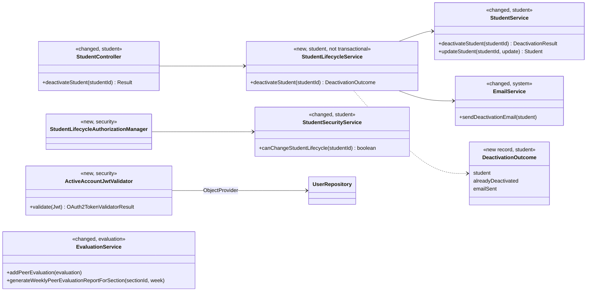
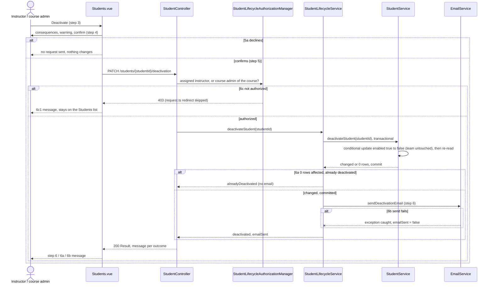
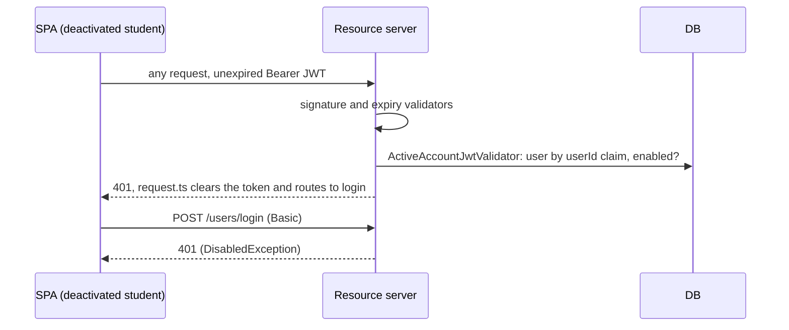
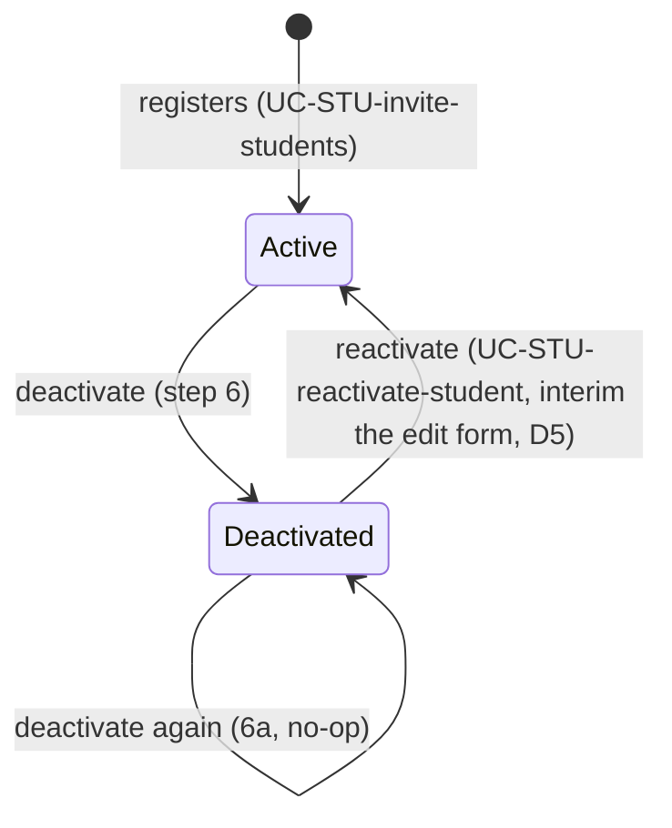

# Students (STU) Design

> Realizes: UC-STU-deactivate-student (with its consequences for UC-EVA-submit-evaluation extension 9a and the UC-EVA-section-evaluation-report listing rule)
> Depends on: FR-SEC-active-account, FR-SEC-authorization, FR-SEC-deny-unauthorized; BR-student-lifecycle, BR-section-scoped-access, BR-submission-owed, BR-role-based-access
> See: [use cases](../requirements/use-cases.md#uc-stu-deactivate-student-the-course-admininstructor-deactivates-a-student), [business rules](../requirements/business-rules.md), [architectural-design.md](architectural-design.md#crosscutting-concepts) (Authorization, Architectural conventions)
> Designed against `main` at `59f0267` (2026-11-06).

## Overview

This area owns a student's account lifecycle. Deactivation is one state change, `PeerEvaluationUser.enabled` going from true to false. It never touches team membership or submitted work (BR-student-lifecycle). The design gives that change one door, a dedicated endpoint that carries the use case's warning, email, and extensions. It then makes the rest of the system honor the state consistently:
- the resource server refuses a deactivated account's live JWT (FR-SEC-active-account);
- the peer evaluation slice stops evaluating her and lists her in the section report only when she was evaluated;
- the notification slice already excludes her from owing (`SubmissionStatusService`, unchanged).

Before this design, deactivation was a side effect of `PUT /students/{id}` toggling `enabled`. It had no warning and no email, it admitted only assigned instructors, and a deactivated student kept working for up to two hours on her token. The evaluation form and `addPeerEvaluation` also still asked for, and accepted, evaluations of her.

## Components & classes

- Backend:
  - [StudentController.java](../../backend/src/main/java/team/projectpulse/student/StudentController.java) and [StudentService.java](../../backend/src/main/java/team/projectpulse/student/StudentService.java) are changed. They gain the deactivate handler and the transactional state change, and `updateStudent` may only reactivate (decision D5). The new `StudentLifecycleService` is deliberately not `@Transactional`: it calls the state change, which commits on return, and only then sends the email (D3).
  - [StudentSecurityService.java](../../backend/src/main/java/team/projectpulse/student/StudentSecurityService.java) is changed, with a new lifecycle check (decision D4).
  - `security/authorizationmanagers/StudentLifecycleAuthorizationManager.java` is new, plus one route rule in [SecurityConfiguration.java](../../backend/src/main/java/team/projectpulse/security/SecurityConfiguration.java).
  - `security/ActiveAccountJwtValidator.java` is new, added to `jwtDecoder()` through a `DelegatingOAuth2TokenValidator` alongside the default validators. It is its own `@Component` taking an `ObjectProvider<UserRepository>`, resolved on each `validate` call. `SecurityConfiguration` takes the validator, not the repository, so it gains no JPA dependency at construction and can't form a cycle (D2). This is the **shared trunk change**: it governs every bearer request, for students and instructors alike.
  - [EmailService.java](../../backend/src/main/java/team/projectpulse/system/EmailService.java) is changed, adding a sender that follows the pattern of the existing ones.
  - [EvaluationService.java](../../backend/src/main/java/team/projectpulse/evaluation/EvaluationService.java) and [PeerEvaluationAverage.java](../../backend/src/main/java/team/projectpulse/evaluation/PeerEvaluationAverage.java) are changed: the 9a check, the listing rule, and a `deactivated` field.
  - [SubmissionStatusService.java](../../backend/src/main/java/team/projectpulse/notification/SubmissionStatusService.java) is reused unchanged. It already applies BR-submission-owed's "account is active" condition.
- Frontend:
  - `apis/student` gains `deactivateStudent`, which sends a per-request flag telling [request.ts](../../frontend/src/utils/request.ts) to skip its `403` toast and forbidden-page redirect (D7). This is a shared change.
  - [Students.vue](../../frontend/src/pages/students/Students.vue) gains a Deactivate row action, shown only for an active student. It opens an `ElMessageBox` with the Associated Information consequences (step 4) and shows the server's message as the result.
  - [EditStudentForm.vue](../../frontend/src/pages/students/EditStudentForm.vue) shows the status toggle only for a deactivated student.
  - [SubmitTeamsEvaluations.vue](../../frontend/src/pages/evaluations/SubmitTeamsEvaluations.vue) lists only `enabled` teammates.
  - The section peer evaluation report view tags a `deactivated` row "Deactivated".

## Sequence

### UC-STU-deactivate-student: deactivate a student

### FR-SEC-active-account: a live session is cut off

### Account state

## API contract

| Endpoint or job | Caller (who may) | Request | Success | Errors, by extension |
|---|---|---|---|---|
| `PATCH /api/v1/students/{studentId}/deactivation` | an instructor assigned to the student's course section, or the course admin of the course it belongs to | none | `200`, `flag` true, `StatusCode.SUCCESS` for every outcome. Data: `{ student: StudentDto, alreadyDeactivated, emailSent }`. <student name> is first and last name. Message: step 6 "<student name> has been deactivated."; 6a "<student name> was already deactivated."; 6b "<student name> has been deactivated, but the notification email could not be sent." | 6c: `403`, `Result` message "No permission." (the access-denied handler delegates to `ExceptionHandlerAdvice`). The call opts out of `request.ts`'s `403` handling, and Students.vue shows "You are not permitted to deactivate <student name>." and stays on the list (D7). An id naming no student is also `403` (fail-closed manager). 5a: no request is sent |
| `PUT /api/v1/students/{studentId}` (changed) | unchanged | an instructor caller sending `enabled: false` for an active student | unchanged otherwise | `400` "Use Deactivate to deactivate a student." (D5) |
| `POST /api/v1/evaluations` (changed; one evaluatee per request) | unchanged | the evaluatee is deactivated | unchanged | UC-EVA-submit-evaluation 9a: `400`, `StatusCode.INVALID_ARGUMENT`, "A deactivated team member is not evaluated." Checked after the existing 1a/1b/1c window and team checks |
| `PUT /api/v1/evaluations/{evaluationId}` (changed) | unchanged | re-submitting an evaluation whose evaluatee is now deactivated | unchanged | 9a: the same `400` (re-submitting is submitting, per BR-student-lifecycle) |
| `GET /api/v1/evaluations/sections/{sectionId}/week/{week}` (changed) | unchanged | unchanged | each row gains `deactivated`; a deactivated student appears only if she received at least one peer evaluation that week, her self-evaluation included. "Deactivated" is her status when the report runs, since no history is stored. Who has not submitted still comes from the notification slice's submission-status endpoint | unchanged |
| any request with a bearer token | — | a JWT whose `userId` names a deactivated account, or no account | — | `401` "The access token provided is expired, revoked, malformed, or invalid…" (`InvalidBearerTokenException`). The SPA redirects to login, where her login fails with the existing disabled-account message |

## Key decisions

- **D1: A dedicated `PATCH /students/{studentId}/deactivation`.** Rejected: keeping deactivation as `enabled: false` on `PUT /students/{studentId}`. A generic profile update can't carry the warning, the email, or the 6a no-op, and it hides a lifecycle change inside a field edit.
- **D2: The session cut-off is a JWT validator that reads `enabled` on each request.** Rejected: a shorter token lifetime, which narrows the window but still leaves one; and a revocation denylist, which adds server state and works against the stateless, multi-instance deployment. Cost: one primary-key read per authenticated request, which is acceptable at about 75 users. The validator fails closed, so a missing, malformed, or unknown `userId` claim is refused. It reads the repository directly, with **no cache**: a cache would reopen the window that FR-SEC-active-account closes. The repository is reached through an `ObjectProvider` so the decoder bean doesn't pull JPA into `SecurityConfiguration`'s constructor; see Components.
- **D3: A conditional update inside a transaction, then the email after commit.** `StudentService.deactivateStudent` runs `UPDATE … SET enabled = false WHERE id = ? AND enabled = true` (`@Modifying(clearAutomatically = true)`), where zero rows affected means 6a. It then re-reads the student, so the response reflects `enabled = false` rather than the stale copy loaded before the bulk update. Two concurrent deactivations therefore produce one change and one email; the other caller gets 6a. The non-transactional `StudentLifecycleService` sends the email only after that transaction has committed. It sends synchronously (`EmailService` has no `@Async`), and any `RuntimeException` from the send is caught, logged, and sets `emailSent = false` (6b). So no row lock is held during SMTP, an SMTP failure can't roll back the deactivation, and no email describes a deactivation that didn't commit. Rejected: read-then-save, where both callers see `enabled = true` and both send (6a1 broken). Rejected: sending inside the transaction, which holds the lock through SMTP and can email about a rolled-back change. Rejected: an `AFTER_COMMIT` `@TransactionalEventListener`. It would work, but returning `emailSent` to the caller would need shared mutable state, whereas an explicit orchestrator returns it plainly.
- **D4: Authorization is a new `canChangeStudentLifecycle` check.** It admits the assigned instructor or the course admin of the student's course, per BR-student-lifecycle and BR-section-scoped-access. Rejected: widening the shared `isCurrentUserInstructorOfStudentSection`. That method guards seven routes with the same course-admin gap: student GET/PUT/DELETE, the three evaluation reads through `UserOwnershipAuthorizationManager`, and evaluation details (OI-65 lists them). Fixing them is a separate access change, tracked as OI-65. The Deactivate row action needs no `GET /students/{studentId}`, so an unassigned course admin can still reach it from the Students list. The use case checks authorization when the deactivation is submitted (6c). The Students list shows only the caller's own default course section, so 6c arises only from a stale page or a hand-made request. Rejected: a permission pre-check endpoint before step 4, which adds a round-trip and a second surface for the same rule.
- **D5: The edit-form status toggle becomes reactivate-only** until UC-STU-reactivate-student is built. `updateStudent` accepts `enabled` false→true and refuses true→false. The refusal sits **inside** the existing instructor-only branch. `StudentDto.enabled` is a primitive, so a student's own profile save arrives as `false`, and that branch already ignores it; a check outside the branch would refuse every student self-edit. Rejected: removing the toggle, which strands a returning student; and keeping it, which leaves a second deactivation path with no warning, no email, and none of the extensions. `enabled: false` for an already-deactivated student is a no-op. The interim path keeps the PUT route's guard, so it sends no reactivation email and refuses the unassigned course admin (OI-65). Both gaps are accepted until UC-STU-reactivate-student is built.
- **D6: Deactivated teammates are filtered out of the evaluation form, and 9a is enforced in both `addPeerEvaluation` and `updatePeerEvaluation`.** Her earlier evaluations stay stored and in the reports, but she no longer appears in the form. Rejected: filtering `GET /students/teams/{teamId}`. Other views (the team roster, WAR reports) correctly show her as an inactive member, because she stays on her team (BR-student-lifecycle).

- **D7: The deactivate call opts out of the global `403` handler.** `request.ts` routes every `403` to the forbidden page, which would hide the 6c1 message and drop the instructor out of the Students list. The call therefore passes a per-request flag that skips the toast and the redirect for that one request, and Students.vue shows the 6c1 message itself. Every other call keeps the global behavior. Rejected: returning `200` with a refusal outcome, which breaks FR-SEC-deny-unauthorized's status semantics and the fail-closed manager pattern.

## Data model

No schema change. `enabled` already exists on `PeerEvaluationUser` (see the SRS's Business Domain Model), and team membership is untouched.

## Reuse & cross-cutting

- Reused:
  - the `Result` envelope and `ExceptionHandlerAdvice`;
  - the `AuthorizationManager` pattern and `SectionSecurityService`'s course-admin lookup;
  - `EmailService` over Gmail SMTP;
  - `SubmissionStatusService` (BR-submission-owed, unchanged), so reminders and the "who has not submitted" lists already skip her;
  - the shared Axios instance's `401` handling, which takes a cut-off student to the login page.
- New machinery: only `ActiveAccountJwtValidator`.

## Tests

| Use case, flow | Level | Asserts |
|---|---|---|
| UC-STU-deactivate-student, main, assigned instructor | integration | `200`, step 6 message; `enabled` false; team unchanged; one email to her address |
| main, course admin of the course, not assigned to the course section | integration | `200` (D4) |
| main, response freshness | integration | the response's `student.enabled` is `false` (D3 re-read) |
| D3, the email follows the commit | unit | `StudentLifecycleService` calls `EmailService` only after `StudentService.deactivateStudent` returns; an exception from the state change sends no email |
| 6c, an instructor not assigned to her course section | integration | `403`; `enabled` unchanged; no email |
| 6c, response body | integration | `403` with `Result` message "No permission."; an id naming no student is also `403` |
| FR-SEC-authorization, a student caller | integration | `403` |
| 5a, declines at the warning | Cypress, API stubbed | no PATCH request is sent |
| 6a, already deactivated | unit + integration | `200`, "<student name> was already deactivated."; the conditional update affects 0 rows; `enabled` stays false; no email |
| 6b, the email cannot be sent | unit + integration (`EmailService` spy throws) | `enabled` false is committed; `200` with `emailSent` false and the 6b message |
| 6c, the SPA keeps the instructor on the list | Cypress, API stubbed `403` | the 6c1 message is shown; no redirect to the forbidden page |
| 6a, concurrent double deactivation | repository / unit | the second conditional update affects 0 rows, so the result is 6a and only one email is sent |
| FR-SEC-active-account, a live JWT after deactivation | integration | her next bearer request is `401`; login is `401` |
| FR-SEC-active-account, a deactivated instructor's live JWT | integration | `401` (the validator is account-generic) |
| consequence: reminders and owing | existing | `SubmissionStatusServiceTest` (a deactivated student owes nothing); `SubmissionStatusServiceIntegrationTest.testAnEvaluationOfADeactivatedTeammateIsNotRequired` (teammates don't owe her) |
| UC-EVA-submit-evaluation 9a, submit | unit + integration | a POST evaluating a deactivated teammate is `400`; nothing saved |
| UC-EVA-submit-evaluation 9a, re-submit | unit + integration | a PUT of an existing evaluation of a now-deactivated teammate is `400`; the evaluation is unchanged |
| UC-EVA-submit-evaluation step 2, form | Cypress, API stubbed | a deactivated teammate is not listed |
| UC-STU-deactivate-student step 3, list | Cypress, API stubbed | Deactivate is shown only for an active student; confirming shows the server's message |
| UC-EVA-section-evaluation-report listing rule | unit | a deactivated student with ≥1 evaluation is listed with `deactivated` true; one with none is omitted; an active student with none is still listed |
| D5, the edit-form toggle | integration | false→true succeeds; true→false is `400`; false→false is a no-op; a student saving her own profile with `enabled: false` succeeds and her status is unchanged (a body omitting `enabled` is `400` malformed, since the DTO field is a primitive) |

Integration tests assert email with a spy on `EmailService` (the `ReminderIntegrationTest` pattern; sends reach the Mailpit container). Fixtures the seed lacks (an unassigned course admin, a deactivated student evaluated in a week) are added to `DataInitializer` or set up in the test.

## Open questions / risks

- The per-request account check (D2) also applies to instructors. FR-SEC-active-account covers both, so this is intended, but it is the first per-request database read on the authentication path.
- OI-65: the other routes guarded by `isCurrentUserInstructorOfStudentSection` refuse the course admin of the course, contrary to BR-section-scoped-access.
